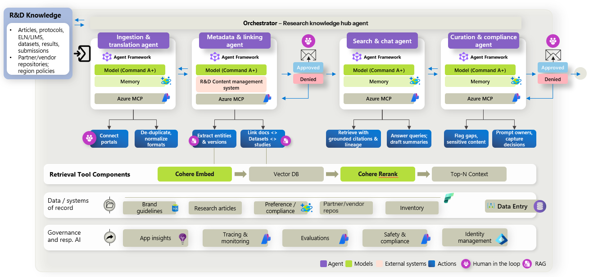

# Agentic R&D knowledge mining with Microsoft Foundry and Cohere models

## Overview

This sample demonstrates an agentic application built with Microsoft Foundry, Microsoft Foundry prompt agents, Agent Framework, Cohere models, MCP tools, and a web frontend.

The application implements a domain-specific multi-agent workflow for HLS R&D knowledge mining (ingestion, indexing, grounded search, and compliance curation over scientific evidence). It includes infrastructure-as-code, generated sample data, backend orchestration, prompt-agent provisioning, and a deployable frontend experience.

[](https://ms.portal.azure.com/#view/Microsoft_Azure_CreateUIDef/CustomDeploymentBlade/uri/https%3A%2F%2Fmusiqa.blob.core.windows.net%2Fpreviewensemble%2Fb8ff3aaa663148be83efaeb4148cfc50.json%3Fsp%3Dr%26st%3D2023-10-08T07%3A58%3A26Z%26se%3D2028-10-08T15%3A58%3A26Z%26spr%3Dhttps%26sv%3D2022-11-02%26sr%3Dc%26sig%3DusR%252FuocPVIEy1ChS9a1cfQ9yRoq%252FtNw3cfhTGRfxI8U%253D/createUIDefinitionUri/https%3A%2F%2Fmusiqa.blob.core.windows.net%2Fpreviewensemble%2F0b159034bef649fba1c5077b67c4caea.json%3Fsp%3Dr%26st%3D2023-10-08T07%3A58%3A26Z%26se%3D2028-10-08T15%3A58%3A26Z%26spr%3Dhttps%26sv%3D2022-11-02%26sr%3Dc%26sig%3DusR%252FuocPVIEy1ChS9a1cfQ9yRoq%252FtNw3cfhTGRfxI8U%253D/templateCustomizationOptions/HideAll/_provisioningContext~/%7B%22initialValues%22%3A%7B%22subscriptionIds%22%3A%5B%22ca1c1b9f-dde6-44c2-bb8e-b03df99f9c1b%22%5D%2C%22resourceGroupNames%22%3A%5B%22DeploymentTestpad-RG%22%5D%2C%22locationNames%22%3A%5B%22eastus%22%5D%7D%2C%22marketplaceItem%22%3A%7B%22categoryIds%22%3A%5B%5D%2C%22id%22%3A%22Microsoft.Portal%22%2C%22itemDisplayName%22%3A%22NoMarketplace%22%2C%22products%22%3A%5B%5D%2C%22version%22%3A%22%22%2C%22productsWithNoPricing%22%3A%5B%5D%2C%22publisherDisplayName%22%3A%22Microsoft.Portal%22%2C%22deploymentName%22%3A%22MaestroStudioDeployment%22%2C%22launchingContext%22%3A%7B%22source%22%3A%5B%22CreateVmBlade%22%2C%22%7BName%3APart%2CType%3A%5B0%5DMicrosoft_Azure_Compute-%5B1%5DCreateVmBlade-%5B2%5DTemplateBladeVirtualLens-%5B5%5DCreateVmBlade%2CId%3APart-CreateVmBlade-2%7D%22%2C%22Part-CreateVmBlade-2%22%5D%2C%22galleryItemId%22%3A%22%22%7D%2C%22deploymentTemplateFileUris%22%3A%7B%7D%2C%22uiMetadata%22%3Anull%7D%7D)

> The Deploy to Azure button deploys the precompiled ARM template generated from the Bicep files in `/infra`. See [`docs/deployment-parameters.md`](./docs/deployment-parameters.md) for template parameters.

## Scenario

Researchers and knowledge curators work with oncology R&D evidence (osimertinib / EGFR-mutated NSCLC) drawn from public sources and synthetic lab records.

- **Block 1 — Ingestion:** read raw knowledge, normalize and link metadata, index to a vector store, then route to a Knowledge Curator for approve/deny.
- **Block 2 — Querying:** Search & Chat over the vector index with citations; on demand, **Curate** runs a Curation & Compliance review over accumulated chat responses, with a Compliance Reviewer gate.

See [`workflow-summary.md`](./workflow-summary.md) for the full business workflow.

## Architecture



## What this sample demonstrates

- Multi-agent orchestration with Agent Framework.
- Prompt-agent provisioning in Microsoft Foundry.
- Use of Cohere models (Command A+, Embed, Rerank) through Microsoft Foundry.
- Retrieval-augmented generation over domain-specific data.
- MCP-based tool access from backend agents.
- End-to-end deployment using Bicep and ARM.
- A frontend experience for running and inspecting the workflow.
- Responsible AI touchpoints such as MCP tool governance, workflow timelines, retrieval trace panels, and human approval.

## Repository structure

| Path | Description |
|---|---|
| `/agent-provisioning` | Scripts and definitions used to create Microsoft Foundry prompt agents. |
| `/backend` | Backend application, main Agent Framework workflow, MCP servers, and REST API used by the frontend. |
| `/data-generation` | Scripts and source assets used to generate synthetic demo data. |
| `/dataset-seed` | Generated sample dataset used by the application. |
| `/docs` | Additional documentation, diagrams, walkthroughs, and design notes. |
| `/frontend` | Frontend application used to run the workflow and inspect results. |
| `/infra` | Bicep templates, compiled ARM templates, and deployment scripts for Azure. |
| `README.md` | Main entry point for understanding, deploying, and running the sample. |

## Prerequisites

Required:

- Azure subscription.
- Access to Microsoft Foundry.
- Access to the required Cohere models in Microsoft Foundry (Command A+, embed-v4, rerank-v4-pro).

Optional:

- Python 3 (only if regenerating the synthetic dataset under `/data-generation`).
- Microsoft Fabric workspace (only when enabling Fabric integration at deploy time).

## Quick deploy

1. Click **Deploy to Azure**.
2. Select the target subscription and resource group.
3. Provide the required model, region, and application parameters. See [`docs/deployment-parameters.md`](./docs/deployment-parameters.md).
4. After the ARM deployment completes, confirm the `run-post-deploy-*` container group reaches `Succeeded`. The runner starts policy seeding and then agent provisioning, which typically takes 15–30 minutes.
5. Open the deployed frontend URL from the deployment output (`frontendUrl`).

> Deployment provisions the Azure resources required to run the sample application. It does not regenerate the synthetic dataset.

Microsoft Fabric integration is **optional**. To enable it, complete the pre-deploy identity steps in [docs/fabric-setup.md](./docs/fabric-setup.md) before deploying with `enableFabric=true`.

## Local development

### 1. Provision infrastructure

Deploy with Bicep from [`infra/main.bicep`](./infra/main.bicep), or use an environment already provisioned by **Deploy to Azure**.

### 2. Provision Foundry prompt agents

See [`agent-provisioning/README.md`](./agent-provisioning/README.md).

### 3. Start the backend

Start **Api.Host** and **RndKnowledgeMining.Mcp**. See [`backend/src/RndKnowledgeMining.Mcp/README.md`](./backend/src/RndKnowledgeMining.Mcp/README.md).

### 4. Start the frontend

```powershell
cd frontend/src/WebApp
dotnet restore Cohere.AgenticRDKnowledge.WebApp.csproj --configfile ../../../NuGet.config --source https://packagefeedproxy.microsoft.io/nuget/v3/index.json
dotnet run --no-restore
```

Default URL: `http://localhost:5147`. Set `ApiBaseUrl` to your running API (local default: `http://localhost:8080/`).

## Configuration

See [`backend/src/RndKnowledgeMining.Mcp/README.md`](./backend/src/RndKnowledgeMining.Mcp/README.md) for MCP settings.

For local debugging, copy or create `backend/src/RndKnowledgeMining.Mcp/appsettings.Deployment.local.json` and fill in your Foundry and Search endpoints.

## Demo walkthrough

1. Open the frontend (`frontendUrl` after deploy, or `http://localhost:5147` locally).
2. Select or review the sample dataset (headline demo: QRY-001 → ING-001 → QRY-002).
3. Start the workflow.
4. Inspect each agent step in the workflow timeline and agent output panels.
5. Review retrieved context, tool calls, model outputs, citations, and final recommendation.
6. Approve or reject the human-in-the-loop decision, when applicable.
7. Use **Reset demo** on the portfolio page to clear the knowledge index and query sessions before re-running the headline sequence.

See [`workflow-summary.md`](./workflow-summary.md) for the seller-ready talk track and scenario catalog.

## Cost and cleanup

This sample creates Azure resources that may incur costs.

Cost analysis and monthly estimates cover Search, Container Apps, Foundry models, and Log Analytics.

- Conservative monthly infrastructure floor: about USD 103.91 (mostly provisioned Search plus Container Apps idle).
- Estimated variable unit costs:
  - Ingestion: about USD 0.255 per run.
  - Search & Chat query: about USD 0.020 per run.
  - Curation/Compliance: about USD 0.015 per run.
- Medium usage projection (300 ingestions, 3,000 queries, 900 curations): about USD 253.91/month.

Primary optimization opportunities:

- Reduce frontend polling traffic (notably repeated calls to scenarios and vector-db/summary).
- Lower idle Container Apps consumption.
- Optimize long and repetitive prompts (prompt cache was not used in the baseline).

For full assumptions, formulas, and service-level breakdowns, see [Client cost analysis](./docs/Client_cost_analysis.md) and [Technical cost methodology](./docs/Technical_cost_calculation_methodology.md).

To avoid continued charges, delete the resource group after completing the demo.

```bash
az group delete --name <resource-group-name> --yes --no-wait
```

## Implementation choices and TODOs

### Prompt agents vs hosted agents

This sample uses **Microsoft Foundry prompt agents** provisioned from `agent-provisioning/`. We initially evaluated **hosted agents**, but the first Agent Framework workflow runs failed when executing agents with:

```text
Required property 'logprobs' is missing
```

The only public reference we found for this error is [microsoft/agent-framework#5854](https://github.com/microsoft/agent-framework/issues/5854). Until that issue is resolved, use prompt agents for Agent Framework orchestration in this sample.

### UI-only workflow completion

The final step of the demo workflow is shown in the **frontend only**; the outcome is **not persisted** by the backend API. Approving or denying the Compliance Reviewer gate after **Curate** does **not** modify vector DB data. Indexed knowledge from Block 1 ingestion remains unchanged.

### Microsoft Fabric integration

Optional Fabric support is implemented at the **MCP layer only**: agents access raw-source data through MCP tools on `/raw-source/mcp`, which can switch between local `dataset-seed` and Fabric OneLake via `DataSource:Mode`. Ingest (inline payloads), normalized storage, Azure AI Search indexes, and the scenario catalog stay on bundled local assets by design.

To enable Fabric, follow [docs/fabric-setup.md](./docs/fabric-setup.md). Seed uploads `dataset-seed/cases/*/ingest` to `Files/bronze/cases/{caseId}/ingest/...` so MCP can read the same relative layout as Local mode.

## Known limitations

- This sample is not production-ready.
- The dataset is synthetic.
- The workflow is optimized for demonstration clarity, not throughput.
- Some deployment settings may require adjustment based on region, quota, and model availability.
- Responsible AI, security, monitoring, and compliance controls must be reviewed before production use.
- Microsoft Fabric integration is optional; see [Fabric setup](./docs/fabric-setup.md).
- Workflow executions and query sessions are kept in memory and are lost if the API restarts.
- RAG retrieval trace panels render when the API returns `retrievalTrace`; not all workflow status responses populate this field yet.

## Related documentation

- [Deployment parameters](./docs/deployment-parameters.md)
- [Fabric setup (optional)](./docs/fabric-setup.md)
- [Agent governance](./docs/agent-foundry-governance.md)
- [Dataset seed](./dataset-seed/README.md)
- [Workflow summary](./workflow-summary.md)
- [Source baseline](./docs/source-baseline.md)

## License

See [LICENSE](./LICENSE.txt) if present in the repository.

## Acknowledgments

The code in this repository was built by the engineering team at [SOUTHWORKS](https://www.southworks.com/). We gratefully acknowledge their expertise and contributions, which made this project possible.
