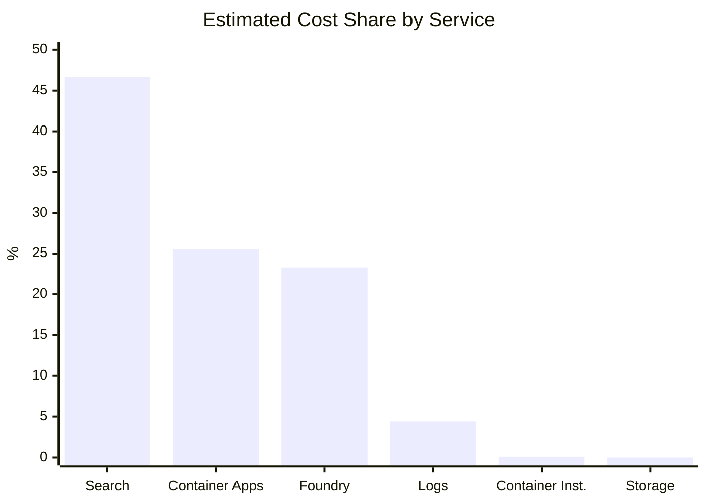

Application cost analysis
Executive summary for client presentation
Currency: USD

# 1. Executive summary

The solution combines provisioned infrastructure costs and variable costs associated with AI model usage. The main optimization opportunity is not user queries, but base infrastructure and repetitive technical traffic generated by the frontend.

| Monthly base projection | USD 103.91 |
| --- | --- |
| Conservative estimate based on provisioned Search and Container Apps idle consumption. |

| Variable cost per ingestion | USD 0.255 |
| --- | --- |
| Estimated average with Grok 4.3, embeddings, and minor reranking. |

| Variable cost per query | USD 0.020 |
| --- | --- |
| Average Search & Chat query, excluding fixed infrastructure allocation. |

| Variable cost per curation | USD 0.015 |
| --- | --- |
| Average curation and compliance run, excluding fixed infrastructure allocation. |

# 2. Cost distribution

| Service | Share |
| --- | --- |
| Azure Cognitive Search | 46.7% |
| Azure Container Apps | 25.5% |
| Foundry Models | 23.3% |
| Log Analytics | 4.4% |
| Container Instances | 0.1% |
| Storage | ~0.0% |

# 3. Costs by execution type

| Execution type | Estimated variable cost | Notes |
| --- | --- | --- |
| Ingestion | USD 0.25-0.26 | Most expensive flow: translation, metadata linking, embeddings, and indexing. |
| Search & Chat query | USD 0.02-0.03 | Low token consumption; fixed Search cost is calculated separately. |
| Curation / Compliance | USD 0.012-0.017 | Low cost per effectively processed request. |

> Unit values represent marginal usage cost. They do not include fixed monthly cost allocation, which decreases per execution as volume increases.

# 4. Monthly projection

Model used: monthly cost = base infrastructure + ingestions x 0.255 + queries x 0.020 + curations x 0.015.

| Scenario | Ingestions | Queries | Curations | Variable | Monthly total |
| --- | --- | --- | --- | --- | --- |
| Low | 100 | 500 | 100 | USD 37.00 | USD 140.91 |
| Medium | 300 | 3,000 | 900 | USD 150.00 | USD 253.91 |
| High | 1,000 | 10,000 | 3,000 | USD 500.00 | USD 603.91 |

```mermaid
xychart-beta
    title "Monthly Cost Projection by Scenario"
    x-axis ["Low", "Medium", "High"]
    y-axis "USD / month" 0 --> 650
    bar "Base Infrastructure" [104, 104, 104]
    bar "Variable Usage" [37, 150, 500]
```

# 5. Findings and recommendations

- Azure Cognitive Search is the largest provisioned cost (~USD 73/month if kept unchanged at the current capacity).
- About 72.5% of Container Apps cost corresponds to idle CPU and memory.
- The ingestion flow is 10 to 15 times more expensive than a user query.
- The frontend generates repetitive calls to scenarios and vector-db/summary. Reducing polling lowers load, logs, and scaling needs.
- Metadata Linking is the agent with the highest average input token consumption (approximately 19,566 per call).
- Prompt cache was not used in the baseline. Long and repetitive prompts represent an additional savings opportunity.

# 6. Conclusion

With the current configuration, the conservative monthly floor is estimated at approximately USD 104, before AI usage is added. For a medium scenario of 300 ingestions, 3,000 queries, and 900 curations per month, the total projection is approximately USD 254. Polling and idle consumption optimization should be applied before using this sample as a definitive production reference.
