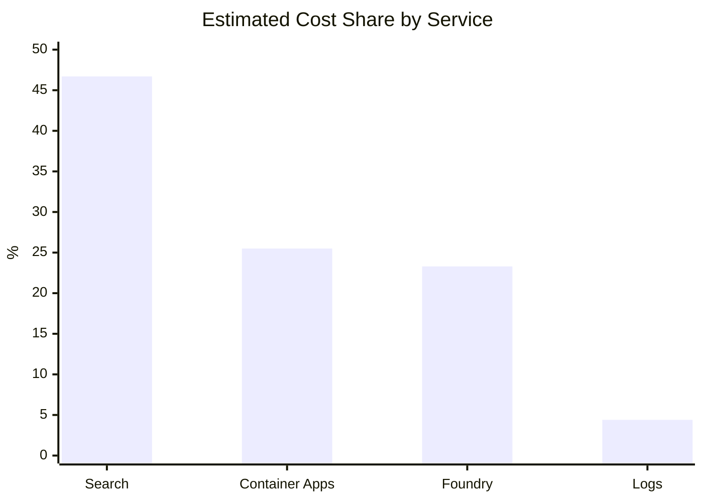

# Technical methodology for cost analysis

Complete calculations, assumptions, and Kusto queries for replication.
Currency: USD

## 1. Scope and sources

This document describes how to reproduce the cost analysis by combining Cost Management, Application Insights, and Log Analytics. The following sources are used:

- Cost export by resource and meter.
- Foundry model cost export by product.
- Agent Framework telemetry for requests, dependencies, and gen_ai dimensions.
- Results from Kusto queries executed over the same time interval as the cost export.

> Consistency rule: all queries must use the same UTC range as the Cost Management export. Exclude partial days when estimating the daily infrastructure base.

## 2. Cost model inputs

| Service | Role in the model | Typical share |
| --- | --- | --- |
| Azure Cognitive Search | Base / provisioned | ~46.7% |
| Azure Container Apps | Base (idle) + approximate variable (active) | ~25.5% |
| Foundry Models | Variable (tokens, embeddings, rerank) | ~23.3% |
| Log Analytics | Approximate variable (telemetry volume) | ~4.4% |
| Container Instances / Storage | Marginal | <0.2% |



## 3. Separation between fixed and variable costs

Classification used for the model:

| Component | Classification | Criteria |
| --- | --- | --- |
| Azure AI Search | Base / provisioned | Billed by provisioned capacity; queries impact load and scaling, but not necessarily immediate cost. |
| Container Apps - Idle | Base | Reserved CPU and memory with no active processing. |
| Container Apps - Active | Approximate variable | Increases with execution duration and load. |
| Foundry Models | Variable | Depends on tokens, embeddings, and reranking. |
| Log Analytics | Approximate variable | Depends on ingested telemetry volume. |
| Storage | Marginal variable | Small cost in the sample. |

Container Apps idle share used in the estimate: ~72.5%.

Conservative monthly base:

```bash
Monthly_base = (Search_daily + ContainerApps_idle_daily) × 30
Monthly_base ≈ USD 103.91
```

## 4. Functional volume and telemetry

HTTP requests are not used as the denominator for cost per execution, because much of the volume corresponds to polling and technical endpoints. Prefer:

| Metric | Use |
| --- | --- |
| Ingestions started | Unit cost for ingestion |
| Search & Chat queries | Unit cost for query |
| Curations started | Unit cost for curation |
| Agent operations / chat spans | Token attribution |

## 5. Consumption by agent and model

Typical relative consumption pattern used for attribution:

| Agent | Model | Relative input intensity |
| --- | --- | --- |
| metadata-linking-agent | grok-4.3 | Highest average input tokens (~19.6k/call) |
| ingestion-translation-agent | grok-4.3 / Cohere Command A / A+ | High (document translation) |
| search-chat-agent | grok-4.3 | Moderate (~3.2k input / ~206 output) |
| curation-compliance-agent | grok-4.3 | Lower (~2.7k input / ~219 output) |

## 6. Unit cost calculation

### 6.1 Ingestion with Grok 4.3

```bash
Ingestion_cost = (translation_cost + metadata_cost + attributable_embeddings + attributable_rerank) / ingestion_count
Ingestion_cost ≈ USD 0.255
```

### 6.2 Search & Chat query

Average estimate used: ~3,191 input tokens and ~206 output tokens per call. Rounded model cost: USD 0.020 per query. Provisioned Search remains in the monthly base.

### 6.3 Curation / Compliance

Average estimate used: ~2,724 input tokens and ~219 output tokens per call. Central operating value: USD 0.015 per curation (range USD 0.012-0.017).

### 6.4 Monthly formula

```bash
Monthly cost = Monthly base + (Ingestions × 0.255) + (Queries × 0.020) + (Curations × 0.015)
```

| Scenario | Base | Variable | Total |
| --- | --- | --- | --- |
| Low | USD 103.91 | USD 37.00 | USD 140.91 |
| Medium | USD 103.91 | USD 150.00 | USD 253.91 |
| High | USD 103.91 | USD 500.00 | USD 603.91 |

## 7. Polling and non-functional traffic finding

High-frequency technical traffic (for example `GET scenarios`, `GET vector-db/summary`, ingestion/curation status polling) increases Search load, telemetry volume, and Container Apps scaling risk without contributing proportional business value. Reduce polling before treating the sample as a production cost reference.

## 8. Kusto queries to reproduce the analysis

Replace `startDate` / `endDate` with the UTC range that matches the Cost Management export.

### 8.1 Daily summary of requests, dependencies, and agents

```kusto
let startDate = datetime(YYYY-MM-DD);
let endDate = datetime(YYYY-MM-DD);
union
(requests | where timestamp between (startDate .. endDate) | summarize Value=count() by Day=startofday(timestamp) | extend Metric="HTTP Requests"),
(dependencies | where timestamp between (startDate .. endDate) | summarize Value=count() by Day=startofday(timestamp) | extend Metric="Dependencies"),
(dependencies | where timestamp between (startDate .. endDate) | where name contains "invoke_agent" | summarize Value=count() by Day=startofday(timestamp) | extend Metric="Agent Operations")
| project Day, Metric, Value
| order by Day asc, Metric asc
```

### 8.2 Functional executions by type

```kusto
requests
| where name in (
  "POST api/rd-knowledge/ingestion/start",
  "POST api/rd-knowledge/query/ask",
  "POST api/rd-knowledge/query/curate/start")
| summarize Executions=count() by Day=startofday(timestamp), ExecutionType=name
| order by Day asc, ExecutionType asc
```

### 8.3 Tokens by agent and model

```kusto
dependencies
| extend Operation=tostring(customDimensions["gen_ai.operation.name"]),
         Agent=tostring(customDimensions["gen_ai.agent.name"]),
         Model=tostring(customDimensions["gen_ai.response.model"]),
         InputTokens=tolong(customDimensions["gen_ai.usage.input_tokens"]),
         OutputTokens=tolong(customDimensions["gen_ai.usage.output_tokens"]),
         ReasoningTokens=tolong(customDimensions["microsoft.foundry.reasoning.tokens"]),
         CachedTokens=tolong(customDimensions["gen_ai.usage.cache_read.input_tokens"])
| where Operation == "chat"
| summarize Calls=count(), TotalInputTokens=sum(InputTokens), TotalOutputTokens=sum(OutputTokens),
            TotalReasoningTokens=sum(ReasoningTokens), AvgInputTokens=round(avg(todouble(InputTokens)),0),
            AvgOutputTokens=round(avg(todouble(OutputTokens)),0), AvgReasoningTokens=round(avg(todouble(ReasoningTokens)),0) by Agent, Model
| order by Calls desc
```

### 8.4 Tokens by agent, model, and day

```kusto
dependencies
| extend Operation=tostring(customDimensions["gen_ai.operation.name"]),
         Agent=tostring(customDimensions["gen_ai.agent.name"]),
         Model=tostring(customDimensions["gen_ai.response.model"]),
         InputTokens=tolong(customDimensions["gen_ai.usage.input_tokens"]),
         OutputTokens=tolong(customDimensions["gen_ai.usage.output_tokens"]),
         ReasoningTokens=tolong(customDimensions["microsoft.foundry.reasoning.tokens"]),
         CachedTokens=tolong(customDimensions["gen_ai.usage.cache_read.input_tokens"])
| where Operation == "chat"
| summarize ChatCalls=count(), InputTokens=sum(InputTokens), OutputTokens=sum(OutputTokens),
            ReasoningTokens=sum(ReasoningTokens), CachedInputTokens=sum(CachedTokens) by Day=startofday(timestamp), Agent, Model
| order by Day asc, Agent asc
```

### 8.5 Embeddings and reranking

```kusto
dependencies
| where target contains "services.ai.azure.com"
| where name contains "embeddings" or name contains "rerank"
| summarize Calls=count(), Successful=countif(success == true), Failed=countif(success == false),
            AvgDurationMs=round(avg(duration),2), P95DurationMs=round(percentile(duration,95),2) by Day=startofday(timestamp), name
| order by Day asc, name asc
```

### 8.6 Azure Search operations

```kusto
dependencies
| where target contains ".search.windows.net"
| summarize Calls=count(), Successful=countif(success == true), Failed=countif(success == false),
            AvgDurationMs=round(avg(duration),2), P95DurationMs=round(percentile(duration,95),2) by Day=startofday(timestamp), name
| order by Day asc, Calls desc
```

### 8.7 Frontend polling

```kusto
requests
| where name contains "/status" or name contains "vector-db/summary" or name contains "/scenarios"
| summarize Requests=count() by Day=startofday(timestamp), name
| order by Day asc, Requests desc
```

### 8.8 Requests by endpoint and performance

```kusto
requests
| summarize Requests=count(), Successful=countif(success == true), Failed=countif(success == false),
            AvgDurationMs=round(avg(duration),2), P95DurationMs=round(percentile(duration,95),2),
            P99DurationMs=round(percentile(duration,99),2) by name, resultCode
| extend SuccessRate=round(100.0 * Successful / Requests,2)
| order by Requests desc
```

### 8.9 Dependencies by destination

```kusto
dependencies
| summarize Calls=count(), Successful=countif(success == true), Failed=countif(success == false),
            AvgDurationMs=round(avg(duration),2), P95DurationMs=round(percentile(duration,95),2) by type, target, name
| extend SuccessRate=round(100.0 * Successful / Calls,2)
| order by Calls desc
```

### 8.10 Billable log volume by table

```kusto
union withsource=TableName *
| summarize Records=count(), EstimatedSizeMB=sum(_BilledSize)/1024.0/1024.0 by Day=startofday(TimeGenerated), TableName
| order by Day asc, EstimatedSizeMB desc
```

## 9. Reproduction procedure

1. Export Cost Management with daily granularity and columns ServiceName, Meter, ResourceId, and CostUSD.
2. Export Foundry costs separately by product/model for the same interval.
3. Run the Kusto queries over the same UTC range.
4. Identify full days and exclude partial days from daily base estimation.
5. Separate provisioned costs (Search and idle) from variable costs (Foundry, active compute, and logs).
6. Calculate functional volumes by start endpoints, not by total requests or dependencies.
7. Attribute tokens using spans where gen_ai.operation.name = chat.
8. Apply the monthly formula and document volume assumptions.

## 10. Limitations and instrumentation improvements

- There are no consistent customDimensions for executionId, sessionId, or workflow.execution_id; operation_Id is not preserved across all hops.
- For this reason, some costs are attributed by aggregation rather than individual trace.
- Adding workflow.execution_id, workflow.type, session_id, and case_id to requests, dependencies, and spans would allow exact workflow-level costing.
- The monthly base depends on Search Units tier and quantity. It must be recalculated if capacity changes.
- Unit costs depend on document size, conversation length, number of tools, and current contractual pricing.

## 11. Central estimate

Central values used: monthly base USD 103.91; ingestion USD 0.255; query USD 0.020; curation USD 0.015. Recalculate periodically with a larger sample and after polling is corrected.
