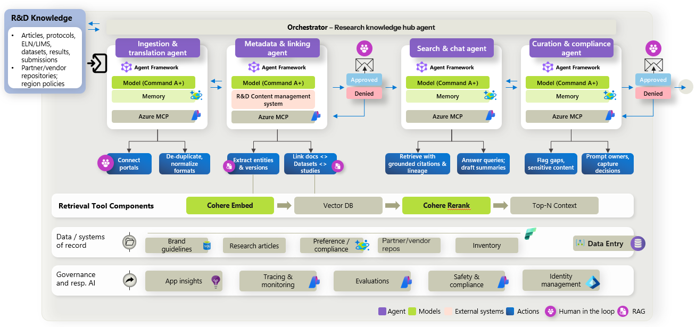

# Architecture

## High-level architecture

The solution splits into two independent blocks bridged by a **Vector DB** (Azure AI Search):

1. **Block 1 — Ingestion:** Fabric or local raw sources → normalize → link metadata → index → Knowledge Curator gate.
2. **Block 2 — Querying:** Search & Chat over the index; optional **Curate** over accumulated responses → Compliance Reviewer gate.

## Agent topology

| Stage | Foundry agent | MCP endpoint |
|---|---|---|
| Block 1 | `ingestion-translation-agent` | `/raw-source/mcp` |
| Block 1 | `metadata-linking-agent` | `/knowledge-search/mcp` |
| Block 2 | `search-chat-agent` | `/knowledge-search/mcp` |
| Block 2 | `curation-compliance-agent` | `/curation-compliance/mcp` |

Each agent connects to a dedicated MCP route. Tool access is restricted per agent through governance policies enforced on the MCP server at runtime. See [agent-foundry-governance.md](./agent-foundry-governance.md).

## Workflow sequence

**Ingestion:** `POST /api/rd-knowledge/ingestion/start` → agent steps → HITL resume → content indexed before curator decision.

**Query — Search & Chat:** `POST /api/rd-knowledge/query/ask` (repeatable, no gate).

**Query — Curate:** `POST /api/rd-knowledge/query/curate/start` (optional `executionId`, typically the query `sessionId`) → Curation & Compliance → HITL resume.

**Demo reset:** `POST /api/rd-knowledge/vector-db/clear-data` and `POST /api/rd-knowledge/query/sessions/reset` — orchestrated by the portfolio **Reset demo** button in the frontend.

## Data flow

1. **Ingest** — Raw knowledge is read from `dataset-seed/cases/{caseId}/ingest/` or Fabric.
2. **Indexing** — Evidence is embedded (Cohere embed-v4) into Azure AI Search.
3. **Retrieval** — Agents query evidence and policies; results are reranked (Cohere rerank-v4-pro).
4. **Structured output** — Each agent returns strict JSON for UI display and HITL decisions.
5. **Human gates** — Knowledge Curator and Compliance Reviewer pauses resume via API.

## MCP integration

The MCP host exposes three HTTP MCP servers. Foundry agents call tools over HTTPS. Each tool invocation is wrapped with AGT policy evaluation when `Governance:EnableMcpToolGovernance` is enabled (default).

| MCP path | Tools |
|---|---|
| `/raw-source/mcp` | list/read raw documents |
| `/knowledge-search/mcp` | search, index, lineage |
| `/curation-compliance/mcp` | policies, sensitivity flags |

Details: [`backend/src/RndKnowledgeMining.Mcp/README.md`](../backend/src/RndKnowledgeMining.Mcp/README.md).

## Model usage

| Model | Deployment (default) | Use |
|---|---|---|
| Cohere Command A+ | `cohere-command-a-plus` | Ingestion, search/chat, and curation/compliance prompt agents |
| Cohere Command A | `cohere-command-a` | Metadata linking on an isolated quota pool |
| Cohere embed-v4 | `cohere-embed-v4` | Document and query embeddings |
| Cohere rerank-v4-pro | `cohere-rerank-v4-pro` | Retrieval reranking |

Models are deployed through Microsoft Foundry as part of [`infra/main.bicep`](../infra/main.bicep).

## Deployment architecture

Bicep deploys Foundry, Search, Storage, Container Apps (API, MCP, frontend), Container Apps Jobs (policy seed, agent provisioning), an Azure Container Instances post-deploy runner, and observability. The runner uses a user-assigned managed identity with explicit Entra ID login to invoke both jobs sequentially; it does not depend on shared-key storage staging. Optional Fabric (`enableFabric=true`) provisions a lakehouse and seeds `cases/*/ingest` into `Files/bronze/cases/...` using an existing UAMI in the same resource group (`fabricIdentityName`, default `fabric-identity`). Fabric support is demo-only and not production-ready.

Template parameters are documented in [deployment-parameters.md](./deployment-parameters.md).

## Security boundaries

- Managed identities connect API and MCP workloads to Foundry, Search, and Storage.
- The post-deploy runner uses Entra ID authentication for Azure management operations.
- MCP tool governance enforces per-agent allow/deny rules and writes audit events to `data/agent-governance-audit` on the MCP host.
- Human approval gates before finalizing sensitive ingestion and curation outcomes.
- Synthetic demo data only; no real patient records in the seed dataset.

See [configuration.md](./configuration.md).
